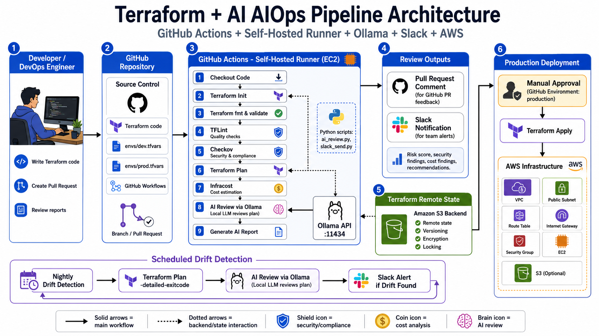

# 🚀 Terraform with AI — Intelligent Infrastructure Review

    

> AI-powered infrastructure review, security scanning, cost estimation and controlled Terraform deployment on AWS.

## 📖 Project Overview

Terraform with AI combines Infrastructure as Code (IaC), DevSecOps and local AI inference to review AWS infrastructure changes before deployment. GitHub Actions orchestrates Terraform planning, static analysis, security scanning and AI-generated recommendations using Ollama on an AWS EC2 self-hosted runner.

The project separates infrastructure review from production deployment, helping engineers identify risks before applying changes.

## 🏗️ Architecture



## ✨ Key Features

- 🏗️ Terraform-based AWS infrastructure provisioning.
- 🤖 Local AI infrastructure review using Ollama and Llama 3.2.
- 🔍 TFLint static analysis and configuration warnings.
- 🛡️ Checkov Infrastructure as Code security scanning.
- 💰 Infracost cloud cost estimation when configured.
- 🔄 Scheduled infrastructure drift detection.
- 📦 S3 remote state configuration for development and production.
- 🚦 Separate manually triggered production apply and destroy workflows.
- 🔔 Slack notification integration.
- ⚙️ GitHub Actions self-hosted runner on AWS EC2.

## 🛠️ Technology Stack

| Technology            | Purpose                              |
|-----------------------|--------------------------------------|
| AWS                   | Cloud infrastructure and EC2 runner  |
| Terraform             | Infrastructure as Code               |
| GitHub Actions        | Workflow orchestration               |
| Ollama / Llama 3.2 3B | Local AI inference                   |
| Python                | AI review automation                 |
| TFLint                | Terraform linting                    |
| Checkov               | Security and compliance scanning     |
| Infracost             | Cloud cost estimation                |
| Amazon S3             | Remote Terraform state               |
| Slack                 | Notifications                        |
| Linux / systemd       | Runner and Ollama service management |

## 🔄 CI/CD Workflow

1.  Developer pushes changes or opens a pull request.
2.  GitHub Actions schedules a job on the self-hosted EC2 runner.
3.  Terraform initializes the backend, validates configuration and generates a plan.
4.  TFLint and Checkov analyze the configuration.
5.  Infracost estimates costs if its API key is configured.
6.  Ollama processes the supplied plan and scan results to generate an advisory review.
7.  Slack integration delivers review notifications when configured.
8.  Production deployment is initiated separately through the manual apply workflow.

## 📂 Repository Structure

``` text
Terraform-with-AI/
├── .github/workflows/          # GitHub Actions workflows
├── ai/                         # AI review automation
├── architucture/
│   └── architecture.png       # Architecture diagram
├── envs/                       # Environment configuration
├── .checkov.yml
├── .tflint.hcl
├── .gitignore
├── .terraform.lock.hcl
├── backend-dev.hcl
├── backend-prod.hcl
├── backend.tf
├── main.tf
├── outputs.tf
├── provider.tf
├── terraform.tfvars
└── variables.tf
```

## ☁️ AWS Infrastructure

The Terraform configuration models AWS networking resources, including a VPC, subnet and security group. Review the actual Terraform plan for the complete resource inventory, network rules and environment-specific settings.

## ⚙️ Getting Started

### Prerequisites

- AWS account with appropriate IAM permissions
- Linux EC2 instance with a configured GitHub Actions self-hosted runner
- Terraform, AWS CLI, Git, Python, TFLint and Checkov
- Ollama installed locally
- Existing S3 state bucket with the correct environment state key
- Optional Infracost API key and Slack incoming webhook

### Clone the repository

``` bash
git clone https://github.com/abhisheksaste31-source/Terraform-with-AI.git
cd Terraform-with-AI
```

### Install and start Ollama

``` bash
curl -fsSL https://ollama.com/install.sh | sh
sudo systemctl enable --now ollama
ollama pull llama3.2:3b
ollama run llama3.2:3b
```

### Start the configured GitHub runner

Run from the existing runner directory. Install the service only if it has not already been installed.

``` bash
cd ~/actions-runner
sudo ./svc.sh install ec2-user
sudo ./svc.sh start
sudo ./svc.sh status
```

### Configure GitHub Actions secrets

Navigate to **Settings → Secrets and variables → Actions**.

| Secret              | Purpose                     |
|---------------------|-----------------------------|
| `INFRACOST_API_KEY` | Enable Infracost analysis   |
| `SLACK_WEBHOOK_URL` | Deliver Slack notifications |

Configure AWS authentication using an appropriately scoped IAM role or the authentication mechanism required by the workflow. Never commit credentials, webhooks or state files.

### Initialize and review Terraform

Review the backend configuration before initialization. Use the existing bucket and state key for the intended environment.

``` bash
terraform init -input=false -backend-config=backend-dev.hcl
terraform fmt -check -recursive
terraform validate
terraform plan -var-file=terraform.tfvars -out=tfplan
```

### Run security checks

``` bash
tflint --init
tflint
checkov -d .
```

## 🤖 AI-Powered Infrastructure Review

Ollama runs locally on the EC2 instance and generates natural-language observations from Terraform plans and tool outputs. The review helps engineers interpret infrastructure changes, warnings, security findings and improvement opportunities.

AI output is advisory: scan exit codes and deterministic policy checks should govern deployment decisions. A Terraform plan does not create resources, and computed values marked known after apply are normal.

## 🔄 Infrastructure Drift Detection

The drift detection workflow is intended to identify differences between Terraform-managed infrastructure and the actual AWS environment. It can be scheduled or manually triggered.

``` yaml
on:
  schedule:
    - cron: "30 3 * * *"
  workflow_dispatch:
```

This example runs daily at 03:30 UTC (09:00 IST). Scheduled workflows must be present on the default branch. Ensure drift detection uses the same remote state as the deployed environment.

## 🚦 Production Deployment

| Workflow                   | Purpose                                    |
|----------------------------|--------------------------------------------|
| Terraform AI Review        | Plan and AI-assisted infrastructure review |
| Terraform PR AI Review     | Pull request review                        |
| Terraform Production Apply | Manually initiated production deployment   |
| Terraform Destroy          | Separate infrastructure removal workflow   |
| Terraform Drift Detection  | Scheduled or manual drift checks           |

Review the plan before initiating production apply. Configure GitHub environment protection and required reviewers where supported; a manual trigger alone is not an approval gate. Destroy operations require particular care.

## 🔐 Security Best Practices

- Restrict SSH access to trusted networks.
- Apply least-privilege IAM permissions.
- Enable S3 state encryption, versioning and compatible state locking.
- Keep secrets and sensitive plan artifacts out of public repositories.
- Avoid running untrusted pull request code on persistent self-hosted runners.
- Treat AI recommendations as advisory, not automatic authorization.

## 📈 Future Enhancements

- Structured JSON-based AI review and deterministic risk classification.
- Policy-as-Code deployment gates.
- Automated pull request review comments.
- Improved cost thresholds and drift reporting.
- Multi-environment and reusable Terraform module support.

## 👨‍💻 Author

**Abhishek Saste**

Cloud & DevOps \| AWS \| Terraform \| DevSecOps \| AI Automation

- GitHub: [abhisheksaste31-source](https://github.com/abhisheksaste31-source)
- Project: [Terraform-with-AI](https://github.com/abhisheksaste31-source/Terraform-with-AI)

------------------------------------------------------------------------

⭐ If you find this project useful, consider starring the repository.
